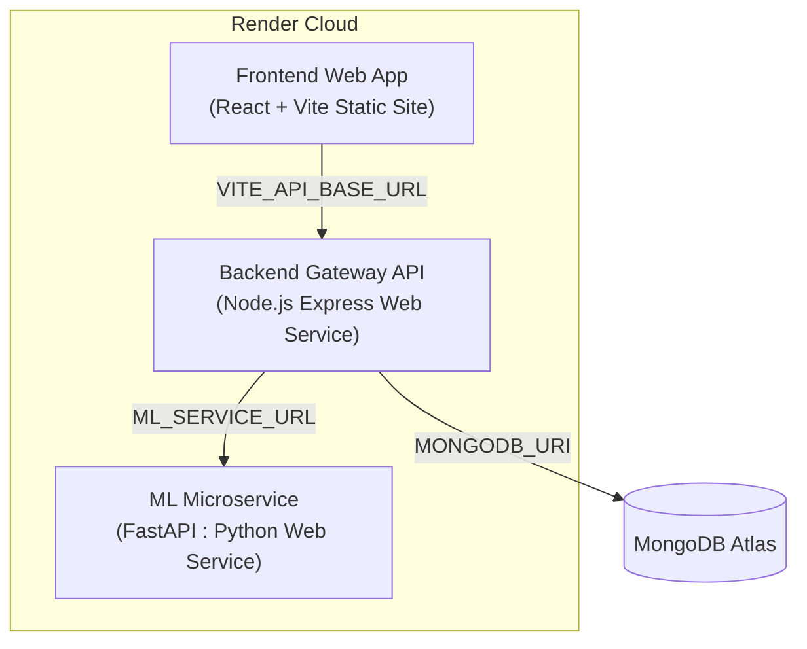

# 🚀 Render Cloud Deployment Guide

This guide outlines how to deploy all three tiers of the **Hyperlocal Monsoon Intelligence System** on [Render](https://render.com).

---

## ⚡ Method 1: One-Click Render Blueprint (Recommended)

The repository includes a `render.yaml` Blueprint specification at the root.

1. Push this repository to **GitHub** or **GitLab**.
2. Go to your [Render Dashboard](https://dashboard.render.com).
3. Click **New +** and select **Blueprint**.
4. Connect your GitHub repository.
5. Render will automatically detect `render.yaml` and configure all three services:
   - `monsoon-ml-service` (Python Web Service)
   - `monsoon-backend-api` (Node.js Web Service)
   - `monsoon-frontend` (Static Site)
6. Click **Apply**.
7. Once the backend finishes deploying, copy its URL (e.g., `https://monsoon-backend-api.onrender.com`), go to the `monsoon-frontend` service **Environment** settings, set `VITE_API_BASE_URL` to `https://monsoon-backend-api.onrender.com/api`, and trigger a manual redeploy.

---

## 🛠️ Method 2: Manual Step-by-Step Setup on Render

If you prefer to configure each service manually via the Render UI:

### Service 1: ML Microservice (FastAPI)
1. In Render Dashboard, click **New +** -> **Web Service**.
2. Connect your repository.
3. Configure the service settings:
   - **Name**: `monsoon-ml-service`
   - **Root Directory**: `SIH/ml-service`
   - **Language / Runtime**: `Python 3`
   - **Build Command**: `pip install -r requirements.txt`
   - **Start Command**: `uvicorn main:app --host 0.0.0.0 --port $PORT`
   - **Health Check Path**: `/health`
4. Click **Create Web Service**.
5. Once live, copy the URL (e.g. `https://monsoon-ml-service.onrender.com`).

---

### Service 2: Backend Gateway (Express.js)
1. In Render Dashboard, click **New +** -> **Web Service**.
2. Connect your repository.
3. Configure the service settings:
   - **Name**: `monsoon-backend-api`
   - **Root Directory**: `SIH/backend`
   - **Language / Runtime**: `Node`
   - **Build Command**: `npm install`
   - **Start Command**: `node server.js`
   - **Health Check Path**: `/health`
4. In the **Environment Variables** section, add:
   | Key | Value | Description |
   | :--- | :--- | :--- |
   | `ML_SERVICE_URL` | `https://monsoon-ml-service.onrender.com` | URL of ML service from Service 1 |
   | `MONGODB_URI` | `mongodb+srv://...` | MongoDB Atlas URI (or leave blank for fallback) |
   | `JWT_SECRET` | *(Any random secret string)* | e.g. `sih-monsoon-secret-key-2026` |
   | `NODE_ENV` | `production` | Production environment |
5. Click **Create Web Service**.
6. Once live, copy the URL (e.g. `https://monsoon-backend-api.onrender.com`).

---

### Service 3: Frontend Web App (React + Vite)
1. In Render Dashboard, click **New +** -> **Static Site**.
2. Connect your repository.
3. Configure the site settings:
   - **Name**: `monsoon-frontend`
   - **Root Directory**: `SIH/frontend`
   - **Build Command**: `npm install && npm run build`
   - **Publish Directory**: `dist`
4. In the **Redirects / Rewrites** section, add an SPA Rewrite Rule:
   - **Source**: `/*`
   - **Destination**: `/index.html`
   - **Action**: `Rewrite`
5. In the **Environment Variables** section, add:
   | Key | Value |
   | :--- | :--- |
   | `VITE_API_BASE_URL` | `https://monsoon-backend-api.onrender.com/api` |
6. Click **Create Static Site**.

---

## 🔍 Verification Checklist

After deployment, check these URLs:
- **ML Health Check**: `https://<your-ml-service>.onrender.com/health` & Swagger at `/docs`
- **Backend Health Check**: `https://<your-backend-api>.onrender.com/health`
- **Frontend App**: `https://<your-frontend>.onrender.com`
